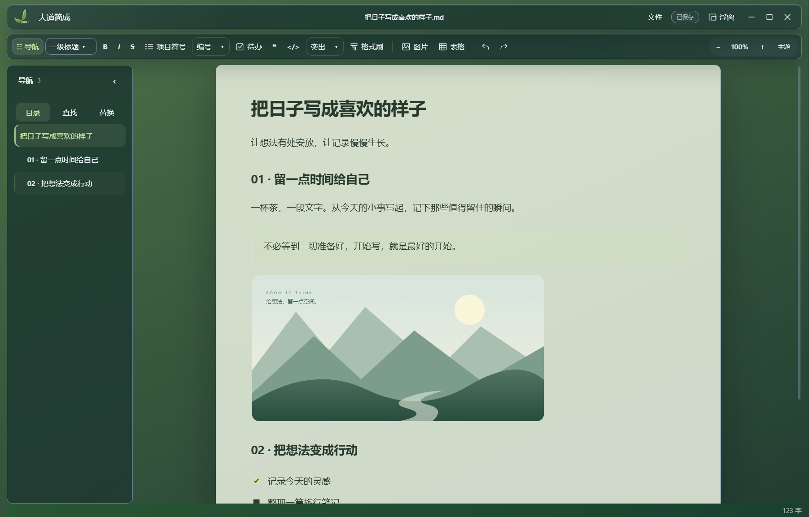
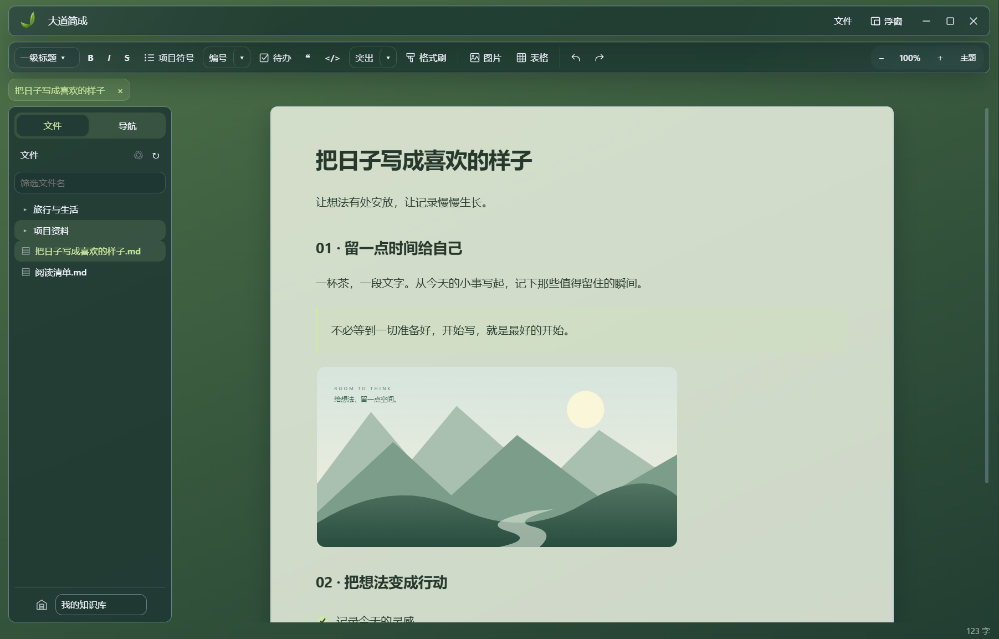
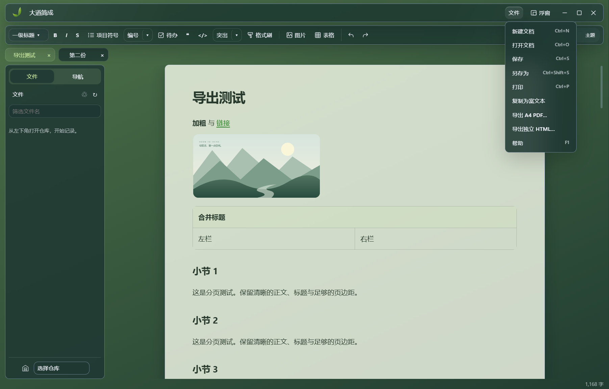
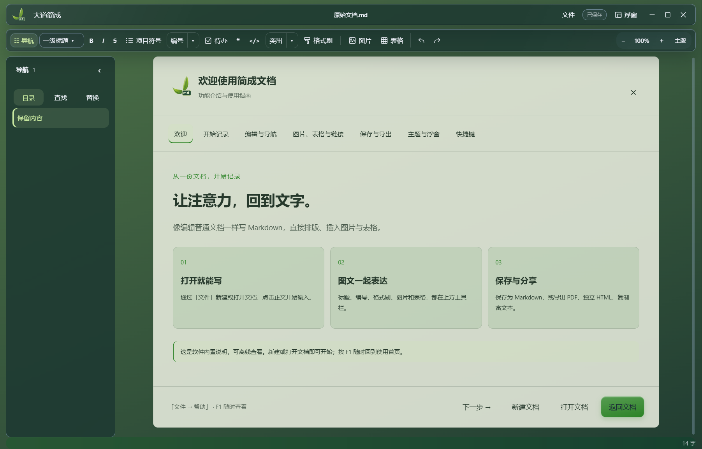

<p align="center"></p>
<h1 align="center">简成文档 · 简成笔记</h1>
<p align="center"><strong>把内容留在本地，把心思留给写作。</strong></p>
<p align="center"><a href="https://github.com/XXLDinosaur/jianchengbiji/releases/latest">下载安装包</a> · <a href="#界面与功能">界面与功能</a> · <a href="#运行与构建">运行与构建</a> · <a href="OPEN_SOURCE.md">开源说明</a></p>

本地优先的 Windows Markdown 写作软件。直接编辑排版后的内容，文档保存在自己的电脑中。

| 产品 | 当前版本 | 定位 | 源码 |
| --- | --- | --- | --- |
| 简成文档（原名成简） | 0.5.7 | 专注单篇文档写作与记录，不包含仓库管理 | 本仓库根目录 |
| 简成笔记 | 0.9.5 | 相同的编辑能力，加上本地仓库、文件夹和多文档标签管理 | [notes/](notes/) |

## 下载与本次更新

Windows x64 MSI 安装包请到 [Releases](https://github.com/XXLDinosaur/jianchengbiji/releases)。安装包未进行代码签名。安装产物与源代码分别发布，源码不包含依赖、用户文档或用户配置。

本次统一采用原文档版的简洁布局：保存、打印、帮助、富文本复制、A4 PDF 与独立 HTML 导出收进右上角「文件」菜单。保留软件内部的离线使用首页、主题、图片与表格编辑和浮窗。笔记版继续保留仓库与标签页。

完整发布说明见 [CHANGELOG.md](CHANGELOG.md)，开源范围与参与方式见 [OPEN_SOURCE.md](OPEN_SOURCE.md)。

## 界面与功能

### 简成文档：打开一份文档，安静写完一个想法

适合日常记录、文章草稿与独立文档。直接在纸张区域编辑，标题、图片、表格和格式工具就在手边。无需先建立仓库。



### 简成笔记：从一篇笔记，生长为自己的资料库

保留相同的编辑体验，增加本地仓库、文件夹、文档标签与内部链接。适合整理项目资料、学习笔记和长期专题。



| 你的使用方式 | 简成文档 | 简成笔记 |
| --- | --- | --- |
| 标题、编号、图片、表格、格式刷 | ✓ | ✓ |
| 目录、查找、替换、主题与浮窗 | ✓ | ✓ |
| 富文本复制、PDF、独立 HTML | ✓ | ✓ |
| 仓库与文件夹管理 | — | ✓ |
| 多文档标签与仓库内文档链接 | — | ✓ |
| 更适合 | 专注写一篇文档 | 写作与资料整理 |

### 从写好，到分享出去

右上角「文件」集中放置保存、打印、复制富文本与导出。图片、表格可以随内容一起分享；独立 HTML 将样式与图片装进一个文件，便于离线阅读。



### 第一次打开，就有上手说明

使用首页直接显示在软件的文档区域，可离线查看。按 F1 或从「文件 → 帮助」随时回来，逐步了解编辑、图片表格、保存导出与快捷键。



> 以上为真实程序截图，文档内容为展示示例；不包含个人仓库或私人文档。

## 编辑与分享

- 所见即所得 Markdown 编辑，标题、编号、项目符号、待办、高亮、格式刷。
- 图片拖入、粘贴、缩放；表格编辑；目录、查找和替换。
- 图片尺寸、空白段落、复杂表格往返保存；高级格式使用内嵌 HTML。
- 文档图片保存到相邻资源目录，搬迁时请同时携带资源文件夹。
- 富文本复制内嵌图片；A4 PDF / 打印；单文件离线 HTML 分享。
- 自定义主题、文档缩放、置顶浮窗、自动保存与软件内帮助。

不同外部编辑器可能过滤 Base64 图片或改变粘贴格式，无法保证所有平台完全一致。自动保存不替代备份。

## 运行与构建

使用 Windows、Node.js 22 及 npm。首次安装依赖需要联网。每个产品在各自目录独立安装依赖、构建：

```sh
# 简成文档：仓库根目录
npm ci
npm start
npm run installer:msi

# 简成笔记
cd notes
npm ci
npm start
npm run installer:msi
```

安装产物位于各自目录的 `发行版/MSI/<版本>/`。`npm run pack` 生成免安装程序目录。界面测试需要交互式桌面会话，使用独立临时用户配置。

```sh
npm run build
node --test tests/core.test.mjs
node tests/exports.cjs
npm run test:welcome
```

## 架构与代码导览

Electron 44 主进程负责窗口、文件、剪贴板与打印；preload 提供受限 IPC。前端采用原生 JavaScript / HTML / CSS，Tiptap 3 / ProseMirror 编辑内核，esbuild 构建，electron-builder 打包 MSI。

| 模块 | 入口 |
| --- | --- |
| 编辑器初始化、图片及表格 | `src/rich-editor.js` |
| Markdown 解析与序列化 | `src/core.mjs`、编辑器自定义序列化规则 |
| 文件与相对资源路径 | `src/files.cjs`、`src/resources.cjs` |
| 富文本、PDF、HTML 导出 | `src/export-ui.js`、`src/export-content.js`、`src/exports.cjs` |
| 文件菜单与内置首页 | `src/file-menu.js`、`src/welcome-guide.js`、`src/welcome-home.css` |
| 编号与格式刷 | `src/block-format.js`、`src/editor-features.js` |
| 仓库与多文档 | `notes/src/vaults.cjs` 及笔记版界面模块 |
| 构建与回归 | `scripts/`、`tests/`，笔记版有独立同名目录 |

历史内部标识 `moye-markdown`、`chengjian-notes` 保留以兼容原有数据目录。当前界面入口是 `rich.html` 和 `rich-editor.js`。

## 许可

项目沿用 [MIT License](LICENSE)，允许使用、修改及再分发，须保留版权与许可声明。第三方组件遵循各自许可证，构建生成 `dist/THIRD-PARTY-NOTICES.txt` 并随软件分发。
